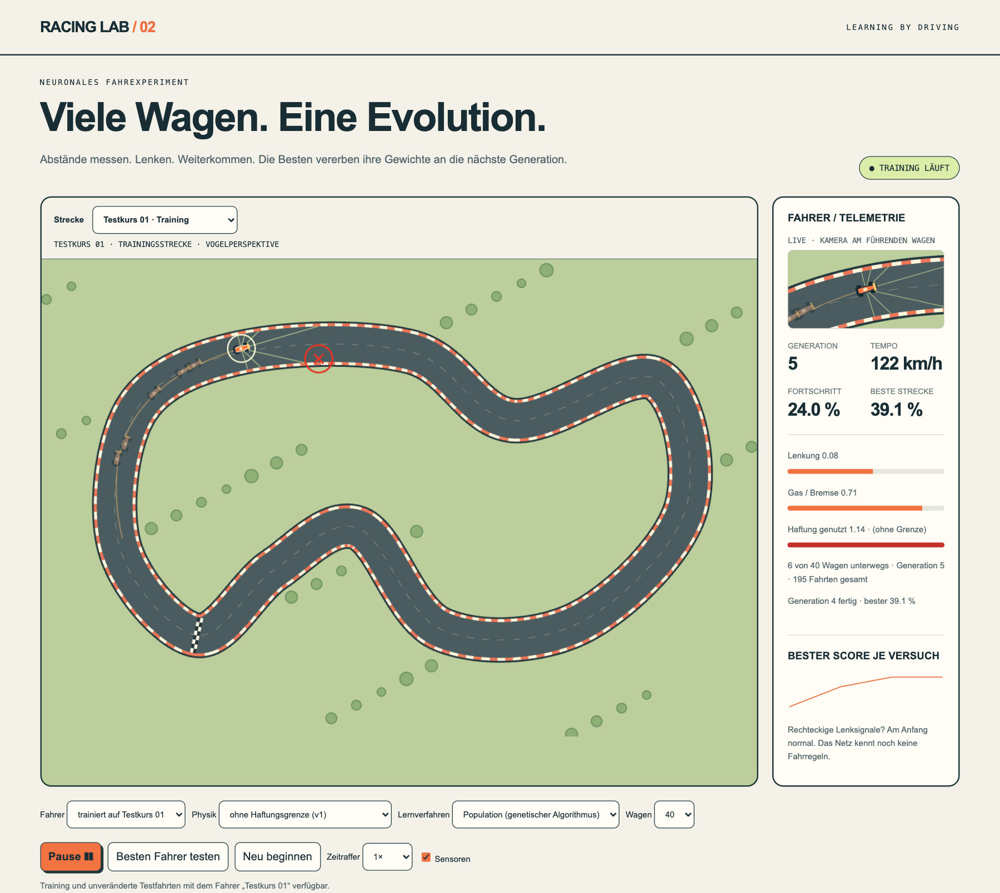
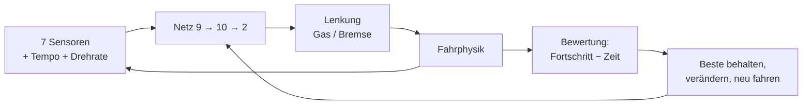
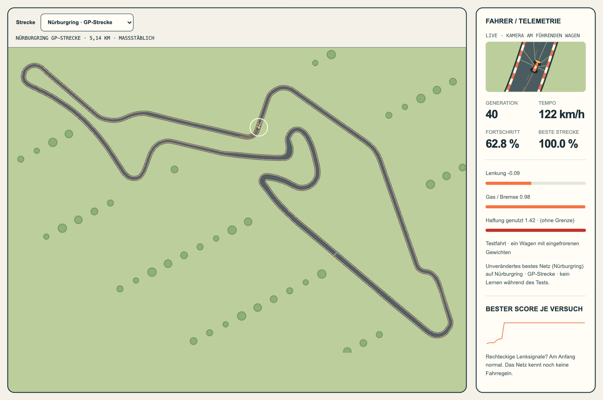
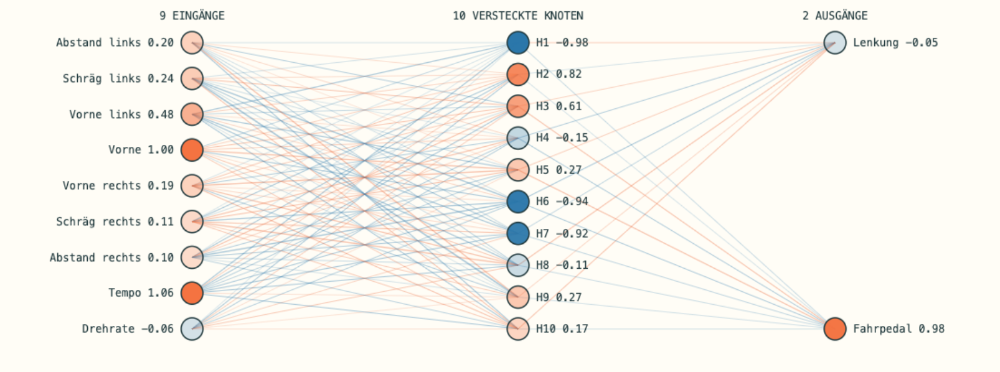
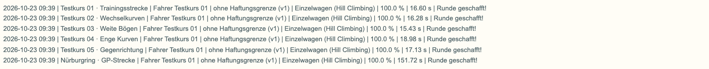

# Racing Lab · ein Wagen lernt fahren

**Ein Formelwagen bekommt sieben Abstandssensoren und ein winziges neuronales Netz und
sonst nichts.** Keine Streckenkarte, keine Ideallinie, keine Fahrregeln. Durch Versuch,
Fehler und Auswahl lernt er trotzdem, eine Runde zu fahren, sogar auf dem Nürburgring.



*Generation 5: 40 Wagen fahren gleichzeitig. Der helle Ring markiert den führenden Wagen,
das rote Kreuz eine Wandberührung. Rechts siehst du, was das Netz gerade entscheidet.*

## In drei Sätzen

1. **Was der Wagen sieht:** sieben Abstände zur Streckenbegrenzung, sein Tempo und seine Drehrate, also 9 Zahlen.
2. **Was er entscheidet:** Ein Netz mit 10 versteckten Neuronen macht daraus 2 Zahlen,
   Lenkung und Gas/Bremse, jeweils zwischen −1 und +1.
3. **Wie er lernt:** Die 122 Gewichte des Netzes werden zufällig verändert. Wer weiter und
   schneller fährt, gibt seine Gewichte an die nächste Generation weiter.



**Das Wichtigste:** Der Wagen merkt sich keine Strecke. Er lernt eine **Reaktionsregel**:
„Wenn die Sensoren das messen, dann lenke und gib Gas so.“ Deshalb fährt ein Fahrer, der
nur auf einer 540-m-Teststrecke trainiert hat, auch die 5,1 km lange Nürburgring-GP-Strecke.

> Spannend war auch, was nicht klappt: Spätere Fahrer wurden schneller, aber nicht
> vielseitiger. Das Netz lernt genau das, was es übt.

## Nürburgring, maßstäblich



*Echte Streckengeometrie (5,14 km, Breite 7,6–21 m). Ein in Python trainierter Fahrer
schafft die Runde in 151 s. Er wurde nach 8 Generationen à 40 Wagen erstmals fertig.*

## Das Netz, live



*Links die 9 Eingänge, in der Mitte 10 versteckte Neuronen, rechts Lenkung und Fahrpedal.
Orange = positiv, blau = negativ. Die Linienbreite zeigt, wie stark ein Gewicht wirkt.
Gewichte ändern sich nur zwischen Versuchen. Die Farben der Knoten ändern sich bei jedem
Zeitschritt der Fahrt.*

## Zwei Lernverfahren zum Vergleichen

| | Einzelwagen (Hill Climbing) | Population (genetischer Algorithmus) |
| --- | --- | --- |
| Idee | ein Wagen, eine leicht veränderte Kopie des Besten, nur Verbesserungen bleiben | 40 Wagen gleichzeitig, die Besten vererben, Kreuzung + Mutation |
| Bild | ein Wanderer mit verbundenen Augen, der nur bergauf geht | 40 Wanderer, die ihre besten Wege teilen |
| Stärke | einfach, sparsam | sucht breiter, bleibt seltener hängen, nutzt alle CPU-Kerne |

Beide Verfahren funktionieren ohne Gradienten. Sie probieren aus und behalten das Bessere.

## Prüfprotokoll: gelernt auf einer Strecke, getestet auf allen



*Ein Fahrer, trainiert nur auf Testkurs 01 (213 Versuche, Einzelwagen), fährt mit
unveränderten Gewichten alle sechs Strecken. Jede Zeile hält Datum, Physik und
Lernverfahren fest.*

## Selbst ausprobieren

**Im Browser**, ohne Installation: Repository klonen oder als ZIP herunterladen und entpacken.
Dann im Hauptordner (`racing-lab` bzw. `racing-lab-main` beim ZIP):

```bash
python3 -m http.server 8000 --bind 127.0.0.1
```

Danach <http://127.0.0.1:8000> öffnen. Die Seite leitet zur aktuellen Version weiter.
Dort **Training starten** klicken. Beenden mit `Strg+C` im Terminal.

> **„Address already in use“?** Auf Port 8000 läuft schon ein anderer Server, oft ein
> vergessener aus einem anderen Terminal. Entweder dort mit `Strg+C` beenden oder einen
> anderen Port nehmen: `python3 -m http.server 8001 --bind 127.0.0.1` und
> <http://127.0.0.1:8001> öffnen.

Fertige Fahrer liegen in `racing-lab-v2/fahrer/` und lassen sich über **JSON-Stand laden** übernehmen.

**In Python**, ohne Zusatzpakete und bitgenau gleich wie der Browser:

```bash
cd racing-lab-v2/python
python3 train.py --track nuerburgring --generations 40 --grip 0     # Population
python3 train.py --method single --attempts 300 --grip 0           # Einzelwagen
python3 replay.py fahrer-nuerburgring-population-seed1.json         # Testfahrt auf allen Strecken
```

Mehr dazu in [`racing-lab-v2/python/README.md`](racing-lab-v2/python/README.md).

## Was wir dabei gelernt haben

- **Schneller heißt nicht vielseitiger.** Fahrer, die auf einer Strecke länger trainiert und
  schneller wurden, scheiterten oft auf anderen. Das ist Überanpassung.
- **Länger trainiert, schlechter auf neuen Strecken.** 81 Generationen mehr Training brachten
  0,12 Sekunden auf der Trainingsstrecke und kosteten zwei Prüfstrecken
  ([Messung](racing-lab-v2/docs/Validierung.md)).
- **Ruhig lenken und Abstand halten: Jetzt klappt es planbar.** Mit Lenkruhe und Abstandsregel
  in der Bewertung schafften alle drei Fahrer eines Experiments den Nürburgring, zwei sogar alle
  Prüfstrecken. Ohne diese Regeln schaffte das keiner. Der Preis: rund 1,3 s pro Runde auf der
  Trainingsstrecke ([Experiment](racing-lab-v2/docs/Validierung.md)).
- **Auch mit echter Reifenhaftung hilft ruhiges Lenken.** Ein im Browser trainierter Fahrer mit
  Haftung, Gleitreibung und Lenkruhe schaffte als erster mit dieser realistischen Physik den
  Nürburgring, insgesamt 5 von 6 Strecken. Er fährt dafür gemächlich (höchstens 82 km/h) und
  bremst nie ([Messung](racing-lab-v2/docs/Validierung.md)).
- **Abstand halten macht vielseitiger.** Mit einer Abstandsregel in der Bewertung (seitlich
  mindestens 2,5 m zur Wand) schafften die Fahrer im Schnitt 3,3 statt 2,0 von 5 Prüfstrecken.
  Das kostete 0,3 s pro Runde ([Experiment](racing-lab-v2/docs/Validierung.md)).
- **Der erste Fahrer war ein Glückstreffer.** Von 19 Fahrern, alle nur auf Testkurs 01
  trainiert, schaffte allein der allererste alle fünf Prüfstrecken. Die übrigen 18 schafften
  eine bis drei.
- **Das Netz lernt, was es übt.** Testkurs 01 besteht zu 75 % aus Rechtskurven. Die Fahrer
  scheitern deshalb vor allem an Linkskurven, etwa in der Gegenrichtung und auf dem Nürburgring.
- **Das Verfahren nutzt jede Lücke im Modell.** Mit Reifenhaftung lernten die Wagen nicht
  zu bremsen, sondern fuhren einfach langsamer oder nutzten das Rutschen als Bremse.
- **Ein Lauf ist keine Statistik.** Vergleiche laufen mit festen Seeds und mehreren
  Wiederholungen ([Validierung](racing-lab-v2/docs/Validierung.md)).

## Entwicklungsstufen

| Version | Was neu ist |
| --- | --- |
| **v1.0** | Ein Wagen, Hill Climbing, fünf Testkurse (`racing-lab-quellcode/`, unverändert) |
| **v2.0** | Population mit genetischem Algorithmus, Nürburgring maßstäblich, Python-Version |
| **v2.1** | Reifenhaftung (1,5 g), wahlweise zuschaltbar |
| **v2.2** | Gleitreibung (Kontrollverlust beim Rutschen), Protokoll mit Datum/Physik/Verfahren, Fahrstil-Analyse |
| **v2.3** | Einzelwagen-Verfahren auch in Python |
| **v2.4** | MIT-Lizenz, Quellenangaben, Repository öffentlich |
| **v2.5** | README mit Bildern; Aufnahmeskript `racing-lab-v2/tools/screenshots.mjs` |
| **v2.6** | Rundenzeit live und Bestzeit je Strecke in der Telemetrie |
| **v2.7** | Bestzeit gehört zum aktuellen besten Fahrer; Skripte mit Versionskennung gegen veraltete Browser-Zwischenspeicher |
| **v2.8** | Bewertung wählbar: Standard oder mit Abstandsregel 2,5 m (Browser und Python) |
| **v2.9** | Lenkruhe in der Bewertung, kombinierbar mit der Abstandsregel; erstmals reproduzierbar vielseitige Fahrer |

Jede Stufe hat ein Git-Tag. Die ausführliche Chronologie steht in
[`racing-lab-v2/docs/Racing-Lab-Chronologie.md`](racing-lab-v2/docs/Racing-Lab-Chronologie.md).
`racing-training.json` ist der ursprünglich im Browser trainierte v1-Fahrer. Er dient als
Referenz für die Paritätstests.

## Lizenz

- **Code, Doku, Testkurse, Bilder und trainierte Fahrer:** MIT (`LICENSE`), © 2026 Florian Englmeier.
  Ausnahme: Die Streckenform in `docs/bilder/02-nuerburgring.png` stammt aus den LGPL-Daten.
- **Streckendaten Nürburgring:** LGPL-3.0, aus der
  [TUMFTM racetrack-database](https://github.com/TUMFTM/racetrack-database) (TU München),
  Kartengrundlage © OpenStreetMap-Mitwirkende. Details: [`NOTICE.md`](NOTICE.md).
- „Nürburgring“ wird nur beschreibend verwendet. Racing Lab ist ein privates Lernprojekt
  ohne Verbindung zur Nürburgring GmbH.
