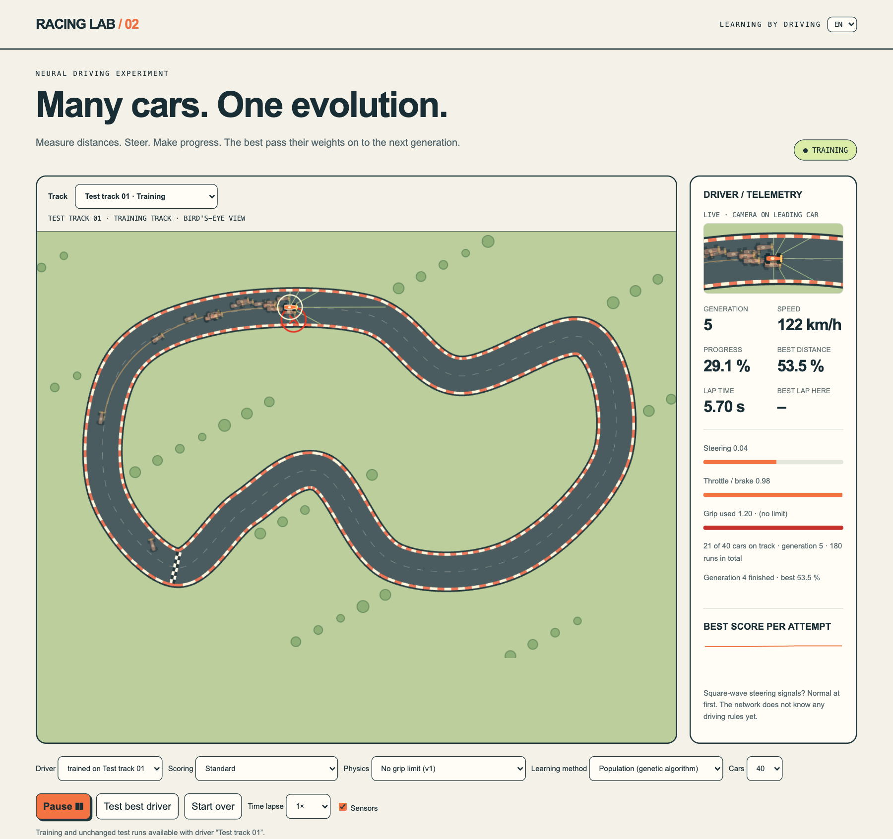
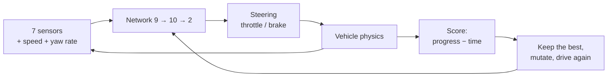
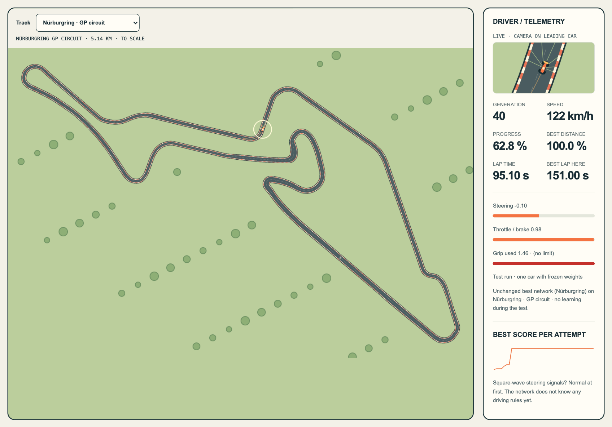
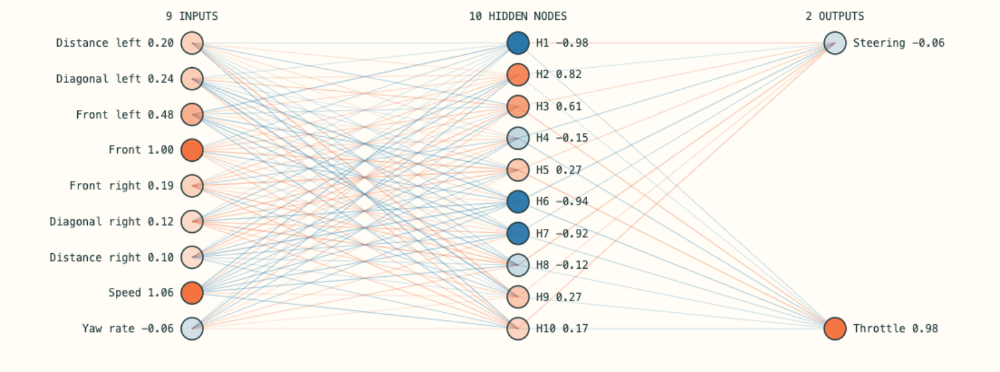
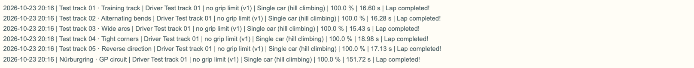

# Racing Lab · a car learns to drive

**English** · [Deutsch](README.de.md)

**A race car gets seven distance sensors and a tiny neural network, and nothing else.**
No track map, no racing line, no driving rules. Through trial, error and selection it still
learns to complete a lap, even on the Nürburgring.



*Generation 5: 40 cars drive at the same time. The bright ring marks the leading car, the red
cross a wall contact. On the right you see what the network is deciding right now.*

## In three sentences

1. **What the car sees:** seven distances to the track edge, its speed and its yaw rate, so 9 numbers.
2. **What it decides:** a network with 10 hidden neurons turns them into 2 numbers,
   steering and throttle/brake, each between −1 and +1.
3. **How it learns:** the network's 122 weights are changed at random. Whoever drives further
   and faster passes their weights on to the next generation.



**The key point:** the car does not memorise a track. It learns a **reaction rule**:
"When the sensors measure this, steer and accelerate like that." That is why a driver trained
only on a 540 m test track can also drive the 5.1 km Nürburgring GP circuit.

> What did not work was just as interesting: later drivers got faster, but not more
> versatile. The network learns exactly what it practises.

## Nürburgring, to scale



*Real track geometry (5.14 km, width 7.6–21 m). A driver trained in Python completes the lap
in 151 s. It first finished after 8 generations of 40 cars each.*

## The network, live



*Left the 9 inputs, in the middle 10 hidden neurons, right steering and pedal.
Orange = positive, blue = negative. Line width shows how strongly a weight acts.
Weights only change between attempts. Node colours change at every time step of the drive.*

## Two learning methods to compare

| | Single car (hill climbing) | Population (genetic algorithm) |
| --- | --- | --- |
| Idea | one car, a slightly mutated copy of the best, only improvements are kept | 40 cars at once, the best pass on their genes, crossover + mutation |
| Picture | a blindfolded hiker who only ever walks uphill | 40 hikers who share their best paths |
| Strength | simple, cheap | searches more broadly, gets stuck less often, uses all CPU cores |

Neither method uses gradients. Both try things out and keep what works better.

## Test log: trained on one track, tested on all



*A driver trained only on test track 01 (213 attempts, single car) drives all six tracks with
unchanged weights. Each row records date, physics and learning method.*

## Try it yourself

**In the browser**, no installation: clone the repository or download and unpack the ZIP.
Then, in the top-level folder (`racing-lab`, or `racing-lab-main` for the ZIP):

```bash
python3 -m http.server 8000 --bind 127.0.0.1
```

Open <http://127.0.0.1:8000>. The page redirects to the current version.
Click **Start training** there. The language can be switched at the top right (EN/DE).
Stop the server with `Ctrl+C` in the terminal.

> **"Address already in use"?** Another server is already running on port 8000, often a
> forgotten one in another terminal. Either stop it there with `Ctrl+C` or use another port:
> `python3 -m http.server 8001 --bind 127.0.0.1` and open <http://127.0.0.1:8001>.

Trained drivers are in `racing-lab-v2/drivers/` and can be loaded with **Load JSON state**.

The drivers in the repository are slim copies. The **full training logs** with the weights of
every attempt and all measurement points are available in the release
[Training data 2026-10-23](https://github.com/bavarian-dataforge/racing-lab/releases/tag/daten-2026-10-23)
(ZIP, 37 MB, with overview and checksums).

**In Python**, no extra packages, bit-for-bit identical to the browser:

```bash
cd racing-lab-v2/python
python3 train.py --track nuerburgring --generations 40 --grip 0     # population
python3 train.py --method single --attempts 300 --grip 0           # single car
python3 replay.py driver-nuerburgring-population-seed1.json         # test run on all tracks
```

More in [`racing-lab-v2/python/README.md`](racing-lab-v2/python/README.md).

## Scoring options

Besides the standard score (progress − time + lap bonus) two optional penalty terms can be
switched on, in the browser and in Python:

- **Clearance rule** (`--clearance`, data code `abstand`): penalises time spent closer than
  2.5 m to the wall at the side, the more the closer the car gets.
- **Steering calm** (`--calm`, data code `ruhe`): penalises the total steering travel, i.e. how
  much the steering moves from step to step. Control engineers know this as a Δu penalty.

The data codes stay German so that older exports keep working.

## What we learned

- **Faster does not mean more versatile.** Drivers that trained longer on one track and got
  faster there often failed on others. That is overfitting.
- **Trained longer, worse on new tracks.** 81 more generations of training gained
  0.12 seconds on the training track and cost two test tracks
  ([measurement](racing-lab-v2/docs/validation.md)).
- **Calm steering and keeping clearance: now it works reliably.** With steering calm and the
  clearance rule in the score, all three drivers of an experiment completed the Nürburgring,
  two of them even all test tracks. Without these rules none did. The price: about 1.3 s per
  lap on the training track ([experiment](racing-lab-v2/docs/validation.md)).
- **Calm steering helps with real tyre grip, too.** A browser-trained driver with grip,
  sliding friction and steering calm was the first to complete the Nürburgring with this more
  realistic physics, 5 of 6 tracks in total. It drives leisurely for that (at most 82 km/h)
  and never brakes ([measurement](racing-lab-v2/docs/validation.md)).
- **Keeping clearance makes drivers more versatile.** With a clearance rule in the score (at
  least 2.5 m to the wall at the side) drivers completed 3.3 instead of 2.0 of 5 test tracks
  on average. It cost 0.3 s per lap ([experiment](racing-lab-v2/docs/validation.md)).
- **The first driver was a lucky hit.** Of 19 drivers, all trained only on test track 01,
  only the very first completed all five test tracks. The other 18 completed one to three.
- **The network learns what it practises.** Test track 01 is 75 % right-hand bends. The
  drivers therefore fail mostly on left-hand bends, for example in the reverse direction and
  on the Nürburgring.
- **The method exploits every gap in the model.** With tyre grip the cars did not learn to
  brake. They simply drove slower or used sliding as a brake.
- **One run is not statistics.** Comparisons use fixed seeds and several repetitions
  ([validation](racing-lab-v2/docs/validation.md)).

## Versions

| Version | What is new |
| --- | --- |
| **v1.0** | One car, hill climbing, five test tracks (`racing-lab-quellcode/`, unchanged, German) |
| **v2.0** | Population with genetic algorithm, Nürburgring to scale, Python version |
| **v2.1** | Tyre grip (1.5 g), optional |
| **v2.2** | Sliding friction (loss of control while sliding), log with date/physics/method, driving-style analysis |
| **v2.3** | Single-car method in Python too |
| **v2.4** | MIT license, attributions, repository public |
| **v2.5** | README with images; capture script `racing-lab-v2/tools/screenshots.mjs` |
| **v2.6** | Live lap time and best lap per track in the telemetry |
| **v2.7** | Best lap belongs to the current best driver; scripts carry a version tag against stale browser caches |
| **v2.8** | Selectable score: standard or with a 2.5 m clearance rule (browser and Python) |
| **v2.9** | Steering calm in the score, combinable with the clearance rule; first reproducibly versatile drivers |
| **v3.0** | Repository in English; bilingual interface (EN/DE switch), older German data stays readable |

Every version has a Git tag. The detailed chronology (in German) is in
[`racing-lab-v2/docs/Racing-Lab-Chronologie.md`](racing-lab-v2/docs/Racing-Lab-Chronologie.md).
`racing-training.json` is the original v1 driver trained in the browser. It serves as the
reference for the parity tests.

## License

- **Code, docs, test tracks, images and trained drivers:** MIT (`LICENSE`), © 2026 Florian Englmeier.
  Exception: the track shape in `docs/images/02-nuerburgring.png` comes from the LGPL data.
- **Nürburgring track data:** LGPL-3.0, from the
  [TUMFTM racetrack-database](https://github.com/TUMFTM/racetrack-database) (TU Munich),
  map data © OpenStreetMap contributors. Details: [`NOTICE.md`](NOTICE.md).
- "Nürburgring" is used descriptively only. Racing Lab is a private learning project with
  no connection to Nürburgring GmbH.
