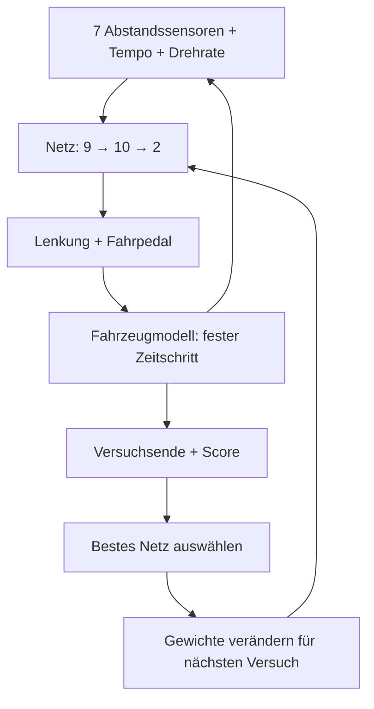

# Technik und Grenzen

## Datenfluss



## Netz und Gewichtsformat

Beide berechnenden Ebenen verwenden `Math.tanh`. Es gibt keine rekurrenten Zustände und keinen Gradientenoptimierer.

| Parameter | Wert |
| --- | --- |
| Architektur | 9 Eingänge → 10 versteckte Knoten → 2 Ausgänge |
| Eingaben | 7 Sensorabstände / 180, Geschwindigkeit / 160, Drehrate / 4 |
| Sensorrichtungen relativ zum Wagen | −1,55; −1,05; −0,5; 0; 0,5; 1,05; 1,55 rad |
| Sensorreichweite | 180 interne Längeneinheiten |
| Verbindungsgewichte | 90 + 20 = 110 |
| Biaswerte | 10 + 2 = 12 |
| Länge des flachen Modellarrays | 122 |

Die Eingaben werden skaliert; die Geschwindigkeit kann bis 170 steigen und damit den Normierungswert 160 übersteigen. Sie sind nicht alle streng auf den Bereich −1 bis +1 begrenzt.

Das Modellarray besteht zuerst aus zehn Gruppen mit je **Bias + neun Eingangsgewichten**. Danach folgen zwei Gruppen mit je **Bias + zehn Gewichten der versteckten Ebene**. Dieses Format wird von JSON-Export und -Import verwendet.

## Fahrzeugmodell

Mit `dt = 1/60` s:

```text
v = clamp(v + (Fahrpedal × Faktor − 0,13 × v) × dt, 0, 170)
Faktor = 85 für positiven Fahrbefehl, sonst 140
Drehrate = v / 22 × tan(Lenkbefehl × 0,52)
Winkel += Drehrate × dt
x += cos(Winkel) × v × dt
y += sin(Winkel) × v × dt
```

Ein negativer Fahrbefehl bremst. Das Auto fährt nicht rückwärts. Der Nullbefehl lässt es unter dem modellierten Widerstand langsamer werden.

Der Comic-Maßstab ist ungefähr 0,2 m je interner Längeneinheit. Die Fahrbahn ist 60 Einheiten breit, also nominal etwa 12 m. Das ist ein Anschauungsmaßstab, keine validierte Formel-1-Fahrdynamik. Die angezeigten km/h ergeben sich aus `v × 0,2 × 3,6`.

## Geometrie und Kollision

Jeder Kurs besteht aus zwölf Kontrollpunkten. Eine geschlossene Catmull-Rom-Kurve wird mit 24 Stichproben je Abschnitt abgetastet. Seitlich um 30 Einheiten versetzte Punkte bilden die Grenzen für die Sensorstrahlen.

Der gerichtete Fortschritt ergibt sich aus der Projektion auf nahe Streckensegmente einschließlich Korrektur am Rundenschluss. Bei mehr als 23 Einheiten Abstand zur Mittellinie wird Wandkontakt ausgelöst. Diese Näherung ersetzt eine vollständige Kollisionserkennung der gedrehten Karosserie. Gezeichnete Fahrbahn und gemessene Grenzsegmente sind ebenfalls diskrete Näherungen derselben Strecke.

Die Sensoren prüfen einen örtlichen Ausschnitt der Begrenzungssegmente um die aktuelle Position. Komplexere Geometrien könnten eine Prüfung aller Begrenzungssegmente erfordern.

## Veränderung und Auswahl

Initial liegen die 122 Parameter zufällig zwischen −0,8 und +0,8. Für einen Nachfolger wird jeder Parameter unabhängig mit 65 % Wahrscheinlichkeit verändert.

Die Veränderungsamplitude ist in 12 % der Mutationen 0,7; sonst liegt sie zwischen 0,12 und 0,32. Die Änderung ist gleichverteilt innerhalb der positiven und negativen Amplitude. Zusätzlich sind ungefähr 5 % der neuen Versuche vollständig zufällige Neustarts. Der beste gespeicherte Fahrer wird dadurch nicht überschrieben.

Die Auswahl akzeptiert nur eine strikt bessere Versuchs-Gesamtbewertung. Das ist eine einfache Suche über Gewichte. Es gibt keine garantierte Konvergenz und keinen Beweis, dass eine gefundene Rundenzeit optimal ist.

## Speicherformat und Grenzen

`localStorage`-Schlüssel:

- `racing-lab-single-driver-v1`: bester Fahrer und begrenzte Protokollhistorie.
- `racing-lab-selected-course-v1`: zuletzt gewähltes Streckenprofil.

Automatisch gespeichert werden die letzten 200 Versuche, 1.000 Messstichproben, 180 Bestscorewerte und 50 Testresultate. Messstichproben entstehen mit ungefähr 5 Hz Simulationszeit, nicht 5 Hz Wandzeit. Im Arbeitsspeicher sind bis zu 10.000 Stichproben vorhanden. Gewichtsänderungen werden pro Trainingsversuch protokolliert.

JSON-Export: vollständiges bestes Modell und aktuell verfügbare Protokolle. CSV-Export: Versuchszähler, Score, Zeit, Fortschritt, Verbesserungsflag und Abbruchgrund; kein Modellimport aus CSV.

Die Aufzeichnung ist kein Experience-Replay-Training. Spätere Verfahren mit Gradienten, PPO oder Replay müssten eigens implementiert werden.

## Methodisch saubere nächste Experimente

1. Modell als unveränderte JSON-Datei archivieren und mit einer Kennung versehen.
2. Generalisierung auf den Kursen 02–05 prüfen, ohne auf ihnen weiterzulernen.
3. Bei identischem Modell und identischen Anfangsbedingungen ist die Testfahrt deterministisch. Wiederholungen derselben Fahrt liefern daher keine unabhängige Robustheitsstichprobe.
4. Für Robustheit später vorher festgelegte Startversätze, Winkel und Geschwindigkeiten variieren.
5. Ein Netz mit mehr Knoten oder ein anderes Lernverfahren erst unter denselben Bedingungen vergleichen.

## Späterer Bezug zu ROS 2

Die Rollen Sensorwerte → Netz → Stellbefehle lassen sich als spätere Schnittstellenidee auf ROS 2 übertragen. Die konkrete Turtle-Umgebung und die Abbildung von Lenkung/Fahrpedal auf Geschwindigkeitsbefehle sind noch offen. Es wurde kein ROS-2-Paket erstellt und kein Transfer auf reale Hardware geprüft.
