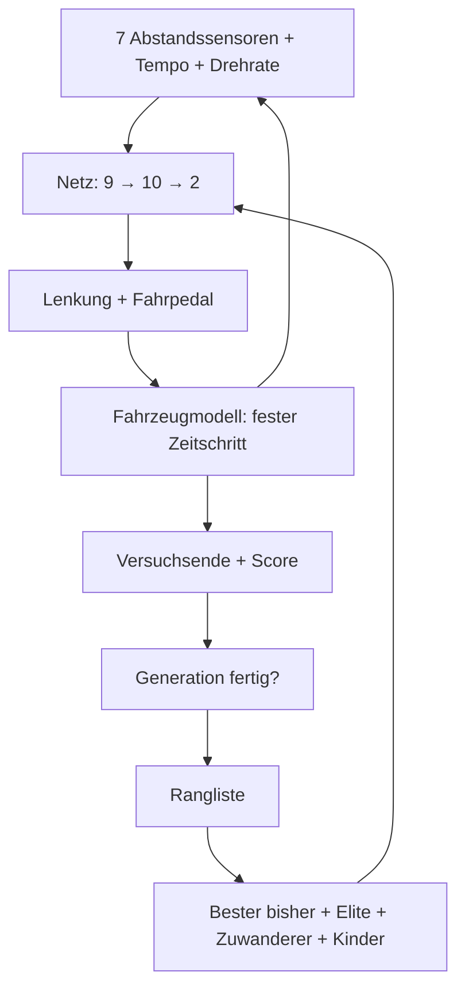

# Technik und Grenzen · v2

## Datenfluss



## Unverändert gegenüber v1

Netz, Eingaben, Sensoren, Fahrzeugmodell, Zeitschritt und Gewichtsformat (122 Werte)
sind identisch. Nachgewiesen wird das in `tests/regression.cjs`: Flos v1-Fahrer fährt in
v2 auf Testkurs 02–05 dieselben Zeiten wie im v1-Protokoll, auf 1/60 s genau. Auch
`python/replay.py` reproduziert sie exakt.

| Parameter | Wert |
| --- | --- |
| Architektur | 9 → 10 → 2, `tanh` |
| Eingaben | 7 Sensorabstände / 180, Geschwindigkeit / 160, Drehrate / 4 |
| Sensorrichtungen | −1,55; −1,05; −0,5; 0; 0,5; 1,05; 1,55 rad |
| Zeitschritt | 1/60 s |
| Höchstgeschwindigkeit | 170 Einheiten/s ≈ 34 m/s ≈ 122 km/h |

## Genetischer Algorithmus (neu)

Nach jeder Generation, wenn alle Wagen ausgeschieden sind:

| Schritt | Anzahl (bei 40 Wagen) | Zweck |
| --- | --- | --- |
| Bester Fahrer bisher | 1 | geht nie verloren |
| Elite | bis 3 weitere | die besten der Generation, unverändert |
| Zuwanderer | 2 | ganz neue Zufallsnetze, gegen Einseitigkeit |
| Kinder | Rest | 2 Eltern per Turnier (3 zufällige, bester gewinnt) → Kreuzung → Mutation |

- **Kreuzung je Neuron:** Ein Kind übernimmt jedes Neuron (Bias + eingehende Gewichte)
  komplett von einem der beiden Eltern. Gewichte, die zusammenarbeiten, bleiben so beisammen.
- **Mutation:** 15 % der Gewichte werden verschoben, meist um ±0,12…0,32 und in 10 % der
  Fälle um bis zu ±0,7. Im Einzelwagen-Modus wie in v1: 65 %.
- **Start mit Vorwissen:** Existiert schon ein bester Fahrer, besteht die erste Generation
  aus ihm und mutierten Kopien.

Alle Wagen starten am selben Punkt und behindern sich nicht (Geisterwagen). Da die
Simulation deterministisch ist, erreicht ein unverändert übernommenes Elite-Netz
denselben Score erneut.

## Bewertung (korrigiert)

```text
Score = min(Fortschritt, Rundenlänge) − 0,6 × Fahrzeit + 500 bei vollständiger Runde
```

In v1 zählte der Überschuss hinter der Ziellinie mit. Daher kam die Anzeige auf
„100,1 %“. In der Python-Trainingsreihe bekam so eine Runde in 16,65 s mehr Punkte als
eine in 16,37 s, weil der langsamere Wagen im letzten Zeitschritt weiter über die Linie
schoss. Mit der Begrenzung gewinnt bei vollständigen Runden immer die schnellere.
Gespeicherte v1-Scores können deshalb um bis zu ~3 Punkte höher sein als neu berechnete.

## Nürburgring

- Quelle: TUMFTM racetrack-database (`Nuerburgring.csv`, LGPL-3.0). Die Mittellinie hat
  einen Punkt alle 5 m und Breiten je Seite.
- Umrechnung (`python/tools/build_nuerburgring.py`): y gespiegelt (Bildschirm-y zeigt
  nach unten), um 84° gedreht, damit die Strecke die 3:2-Fläche füllt, 1 m = 5 Einheiten.
- 1.029 Punkte, 5.144 m, Breite 7,6–21 m. Zeitlimit 600 s, Sensorfenster ±12 Segmente.
- **Wandkontakt** jetzt seitenabhängig: Abstand zur Mittellinie > Breite der jeweiligen
  Seite − 7 Einheiten (1,4 m). Bei den Testkursen (30 je Seite) ergibt das wie in v1 23.
- Darstellung: Übersicht 1,44 m pro Pixel. Die Wagen werden dort vergrößert gezeichnet,
  sonst wären sie nur einen Pixel groß. Die Wagenkamera zeigt den echten Maßstab.

## Haftungsgrenze (v2.1)

Wählbar über **Physik**: „mit Haftungsgrenze 1,5 g“ (Standard) oder „ohne Haftungsgrenze (v1)“.
Jede Physik hat eigene Fahrerstände (`…-grip` im Speicherschlüssel). JSON-Dateien tragen
`physics: {model: "kamm", grip: 1.5}`, und der Import schaltet passend um.

**Modell: Kammscher Kreis.** Die Reifen übertragen höchstens `a_max = µ·g = 1,5 · 9,81 m/s²`.

```text
quer      = min(v · |gewünschte Drehrate|, a_max)     Kurvenfahrt hat Vorrang
rest      = sqrt(a_max² − quer²)                       Budget für Gas/Bremse
reifen    = Fahrpedal-Beschleunigung, begrenzt auf ±rest
v         = v + (reifen − 0,13·v)·dt                   Luftwiderstand ist nicht reifenbegrenzt
Drehrate  = gewünscht, höchstens a_max / v             mehr geht nicht → Wagen schiebt nach außen
Rutschen  = 1 − (a_max/v) / |gewünscht|  (0…1)
v         = v − Rutschen · 0,5 · a_max · dt             Reibverlust beim Rutschen
```

Folgen: Bei 34 m/s braucht eine Kurve mindestens 78 m Radius. Engere Kurven gehen nur
mit weniger Tempo, und im Kurvenscheitel bleibt kaum Haftung zum Bremsen. Deshalb muss
vorher gebremst werden. Netz, Eingänge und Gewichtsformat bleiben unverändert (9–10–2).
Das Netz „spürt“ das Rutschen nur indirekt über Drehrate und Tempo.

Messwerte und Beobachtungen stehen in `Validierung.md`.

## Gleitreibung / Kontrollverlust (v2.2)

In v2.1 kostete Rutschen nur Tempo. Die gelernten Fahrer nutzten es deshalb als Bremse,
bremsten selten mit dem Pedal und rutschten bis zu 46 % der Fahrzeit. v2.2 bildet nach,
dass ein rutschender Reifen weniger hält als ein haftender (Gleitreibung < Haftreibung):

```text
Grenze = µ·g                 solange der Wagen haftet
Grenze = 0,7 · µ·g            sobald er im vorigen Zeitschritt gerutscht ist (SLIDE = 0,7)
```

Die kleinere Grenze gilt für Seitenführung **und** Bremsen. Wer einmal rutscht, kommt
deshalb weiter nach außen und kann schlechter bremsen. Haftung bekommt er erst zurück,
wenn Tempo × Drehrate wieder unter die Gleitgrenze fällt (Hysterese). Mit SLIDE = 1
rechnet der Code exakt wie v2.1. Das ist durch Parität geprüft.

Physik-Auswahl im Browser: „Haftung 1,5 g + Gleitreibung (v2.2)“ (Standard), „… ohne
Gleitreibung (v2.1)“, „ohne Haftungsgrenze (v1)“. Jede Variante hat eigene Fahrerstände.
JSON: `physics: {model: "kamm", grip: 1.5, slide: …}`. Python: `--slide` in `train.py`,
`replay.py`, `analyze.py`.

Einen Score-Abzug fürs Rutschen gibt es bewusst nicht. Ein Abzug würde nur das Symptom
bestrafen, die Physik dagegen macht Rutschen von selbst unattraktiv.

## Weitere Grenzen

- Alle Wagen starten identisch. Robustheit gegen andere Startbedingungen wird nicht trainiert.
- Kollision über den Mittelpunktabstand, keine gedrehte Karosserie.
- Sensoren prüfen nur Begrenzungen im lokalen Fenster um den Wagen.
- Es gibt keine Garantie, dass der GA das Optimum findet. Unterschiedliche Seeds liefern
  unterschiedliche Fahrer.

## Speicherung

`localStorage`-Schlüssel: `racing-lab-v2-driver-training`, `racing-lab-v2-driver-nuerburgring`,
`racing-lab-v2-course`, `racing-lab-v2-active-driver`. Wird unter derselben Adresse ein
v1-Stand (`racing-lab-single-driver-v1`) gefunden, wird er als Fahrer „Testkurs 01“ übernommen.

JSON-Export: Format v1-kompatibel (`formatVersion: 1`, `bestWeights`) plus
`trainingTrackId`, `population`, `generation`. Im Arbeitsspeicher werden bis zu 5.000
Versuchsprotokolle gehalten, exportiert werden die letzten 2.000.
