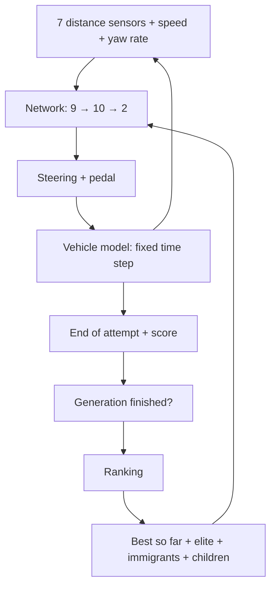

# Technical notes and limits · v2

## Data flow



## Unchanged from v1

Network, inputs, sensors, vehicle model, time step and weight format (122 values) are
identical. This is verified in `tests/regression.cjs`: Flo's v1 driver drives the same times
on test tracks 02–05 in v2 as in the v1 log, to within 1/60 s. `python/replay.py` reproduces
them exactly as well.

| Parameter | Value |
| --- | --- |
| Architecture | 9 → 10 → 2, `tanh` |
| Inputs | 7 sensor distances / 180, speed / 160, yaw rate / 4 |
| Sensor directions | −1.55; −1.05; −0.5; 0; 0.5; 1.05; 1.55 rad |
| Time step | 1/60 s |
| Top speed | 170 units/s ≈ 34 m/s ≈ 122 km/h |

## Genetic algorithm (new)

After each generation, once all cars are out:

| Step | Count (with 40 cars) | Purpose |
| --- | --- | --- |
| Best driver so far | 1 | is never lost |
| Elite | up to 3 more | the best of the generation, unchanged |
| Immigrants | 2 | entirely new random networks, against one-sidedness |
| Children | the rest | 2 parents by tournament (3 random, best wins) → crossover → mutation |

- **Crossover per neuron:** a child takes each neuron (bias + incoming weights) entirely
  from one of the two parents. Weights that work together stay together.
- **Mutation:** 15 % of the weights are shifted, mostly by ±0.12…0.32 and in 10 % of cases by
  up to ±0.7. In single-car mode as in v1: 65 %.
- **Start with prior knowledge:** if a best driver already exists, the first generation
  consists of it and mutated copies.

All cars start at the same point and do not obstruct each other (ghost cars). Since the
simulation is deterministic, an elite network carried over unchanged reaches the same score
again.

## Score (corrected)

```text
Score = min(progress, lap length) − 0.6 × driving time + 500 for a completed lap
```

In v1 the overshoot past the finish line counted too. That is why the display reached
"100.1 %". In the Python training series a lap in 16.65 s thus got more points than one in
16.37 s, because the slower car shot further over the line in its last time step. With the
cap, the faster lap always wins among completed laps. Stored v1 scores can therefore be up
to ~3 points higher than recomputed ones.

## Scoring options (v2.8, v2.9)

Two optional penalty terms, selectable under **Scoring** in the browser and with
`--clearance` / `--calm` in Python:

```text
near         += (2.5 m − d) / 2.5 m · dt      per time step with lateral distance d < 2.5 m
steerTravel  += |steer − previous steer|      per time step
Score        −= 100 · near                    clearance rule
Score        −= 2 · steerTravel               steering calm
```

`d` is the shorter of the two outermost sensors (left and right). Steering calm is the
discrete form of a Δu penalty as used in MPC (move suppression). The data codes in JSON
stay German for compatibility: `standard`, `abstand`, `ruhe`, `abstand+ruhe`.

## Nürburgring

- Source: TUMFTM racetrack-database (`Nuerburgring.csv`, LGPL-3.0). The centre line has a
  point every 5 m and widths per side.
- Conversion (`python/tools/build_nuerburgring.py`): y mirrored (screen y points down),
  rotated by 84° so that the track fills the 3:2 area, 1 m = 5 units.
- 1,029 points, 5,144 m, width 7.6–21 m. Time limit 600 s, sensor window ±12 segments.
- **Wall contact** now depends on the side: distance to the centre line > width of that side
  − 7 units (1.4 m). For the test tracks (30 per side) this gives 23, as in v1.
- Display: overview 1.44 m per pixel. The cars are drawn enlarged there, otherwise they would
  be a single pixel. The car camera shows the real scale.

## Grip limit (v2.1)

Selectable under **Physics**: "with grip limit 1.5 g" (default) or "no grip limit (v1)".
Each physics has its own driver states (`…-grip` in the storage key). JSON files carry
`physics: {model: "kamm", grip: 1.5}`, and the import switches accordingly.

**Model: Kamm's circle.** The tyres transmit at most `a_max = µ·g = 1.5 · 9.81 m/s²`.

```text
lateral   = min(v · |desired yaw rate|, a_max)       cornering has priority
rest      = sqrt(a_max² − lateral²)                    budget for throttle/brake
tyre      = pedal acceleration, limited to ±rest
v         = v + (tyre − 0.13·v)·dt                     air drag is not tyre-limited
yaw rate  = desired, at most a_max / v                 no more possible → car pushes outwards
slip      = 1 − (a_max/v) / |desired|  (0…1)
v         = v − slip · 0.5 · a_max · dt                friction loss while sliding
```

Consequences: at 34 m/s a bend needs a radius of at least 78 m. Tighter bends only work at
lower speed, and at the apex there is hardly any grip left for braking. So the car has to
brake beforehand. Network, inputs and weight format stay unchanged (9–10–2). The network
"feels" sliding only indirectly through yaw rate and speed.

Measurements and observations are in `validation.md`.

## Sliding friction / loss of control (v2.2)

In v2.1 sliding only cost speed. The trained drivers therefore used it as a brake, rarely
braked with the pedal and slid up to 46 % of the driving time. v2.2 models that a sliding
tyre holds less than a gripping one (sliding friction < static friction):

```text
limit = µ·g                  while the car grips
limit = 0.7 · µ·g            as soon as it slid in the previous time step (SLIDE = 0.7)
```

The lower limit applies to cornering **and** braking. Once a car slides, it therefore drifts
further outwards and brakes worse. It only regains grip when speed × yaw rate falls below
the sliding limit again (hysteresis). With SLIDE = 1 the code computes exactly like v2.1.
This is verified by parity.

Physics choice in the browser: "grip 1.5 g + sliding friction (v2.2)" (default), "… without
sliding friction (v2.1)", "no grip limit (v1)". Each variant has its own driver states.
JSON: `physics: {model: "kamm", grip: 1.5, slide: …}`. Python: `--slide` in `train.py`,
`replay.py`, `analyze.py`.

There is deliberately no score penalty for sliding. A penalty would only punish the symptom,
whereas the physics makes sliding unattractive by itself.

## Further limits

- All cars start identically. Robustness against other starting conditions is not trained.
- Collision via the centre-point distance, no rotated car body.
- Sensors only check boundaries within the local window around the car.
- There is no guarantee that the GA finds the optimum. Different seeds give different drivers.

## Storage

`localStorage` keys: `racing-lab-v2-driver-training`, `racing-lab-v2-driver-nuerburgring`,
`racing-lab-v2-course`, `racing-lab-v2-active-driver`, `racing-lab-lang`. If a v1 state
(`racing-lab-single-driver-v1`) is found under the same address, it is taken over as the
"Test track 01" driver.

JSON export: v1-compatible format (`formatVersion: 1`, `bestWeights`) plus
`trainingTrackId`, `population`, `generation`. Up to 5,000 attempt records are kept in
memory; the last 2,000 are exported.

Labels in `meta` and in the test log are written in English. Exports from before v3.0 with
German labels and result texts (`Runde geschafft!`, `Wandkontakt`, …) are still read; the
result texts are mapped to the English codes on import.
